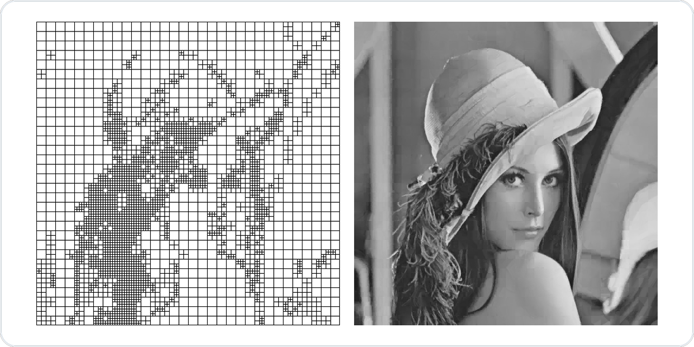

<h1 align="center">Fractal Mars</h1>

<p align="center">A quadtree fractal image coder and decoder in C, by Mario Polvere (1998).</p>

<p align="center">
  <a href="#quick-start"><b>Quick start</b></a> &nbsp;·&nbsp;
  <a href="#documents">Documents</a> &nbsp;·&nbsp;
  <a href="#how-it-works">How it works</a> &nbsp;·&nbsp;
  <a href="docs/original-README.md">Original README</a>
</p>

<p align="center">
  
</p>

Mars is Mario Polvere's program from the University of Salerno for comparing
ways of speeding up fractal image coding. It stores an image as a set of
transformations that map larger parts of the image onto smaller ones, and
rebuilds it by applying them over and over. With its default settings it codes
the 512×512 greyscale Lena above into 15,814 bytes (16.6:1) at 33.5 dB in
under half a second. The code is his, under the GPL; this copy only fixes the
build for current compilers. A Rust rewrite lives on in
[mars](https://github.com/daleobrien/mars).

## Quick start

```bash
make                  # builds encmars and decmars
./encmars -Q          # lena.raw -> lena.ifs, plus quadtree.pgm
./decmars             # lena.ifs -> lena.dec.pgm
./encmars -h          # every option
```

Input is raw (512×512 by default, set with `-W` and `-H`) or PGM greyscale; see
[Encoding and decoding](docs/usage.md).

## Documents

| Document | What's in it |
| -------- | ------------ |
| [Encoding and decoding](docs/usage.md) | The two programs, the options that matter most, and the output files |
| [Speed-up methods](docs/methods.md) | The six codebook searches and how they compare on Lena |
| [MANUAL.txt](MANUAL.txt) | The author's manual: every option, with references |
| [Original README](docs/original-README.md) | The author's README from 1998: licence, features, known bugs, acknowledgements |
| [COPYING.txt](COPYING.txt) | The GNU General Public License, version 2 |

## How it works

The image is split into a quadtree of range blocks, from 16×16 down to 4×4,
splitting wherever a block can't be matched well enough. Each range block is
matched against a codebook of domain blocks twice its size, shrunk and turned
through the eight rotations and flips, and stored as which domain, which
isometry, and a quantised scale and offset for its brightness. Searching the
whole codebook is slow, so the coder first narrows it down by classifying
blocks (Fisher, Hurtgen) or by a nearest-neighbour search over feature vectors
(Saupe, mass centre). The decoder starts from any image and applies the
transformations until it settles, either at full size or growing from a small
image (pyramidal decoding), which also lets it zoom.
[Speed-up methods](docs/methods.md) has the details.

---

<p align="center"><sub>Part of <a href="https://daleobrien.github.io/#engineering">Engineering</a> &nbsp;·&nbsp; more at <a href="https://daleobrien.github.io">daleobrien.github.io</a></sub></p>
